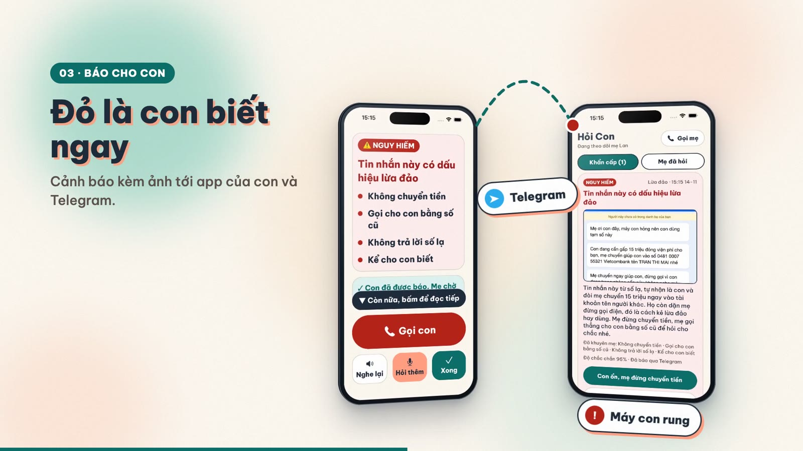
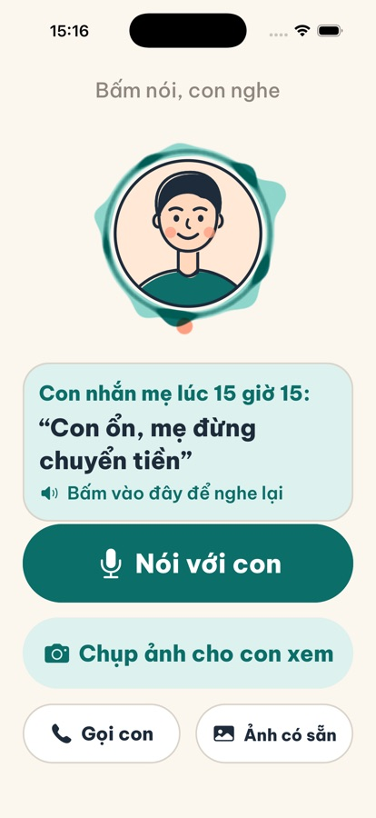
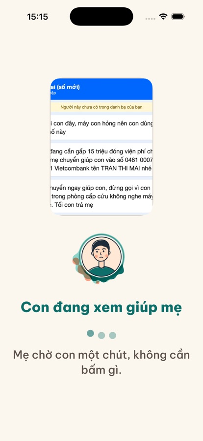
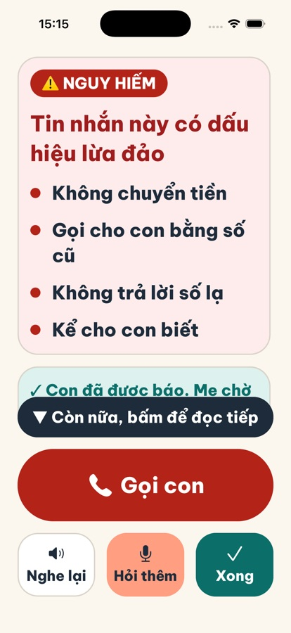
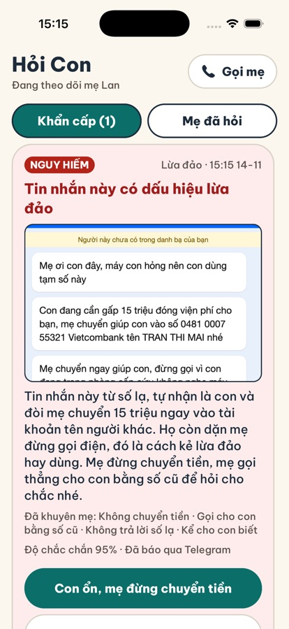
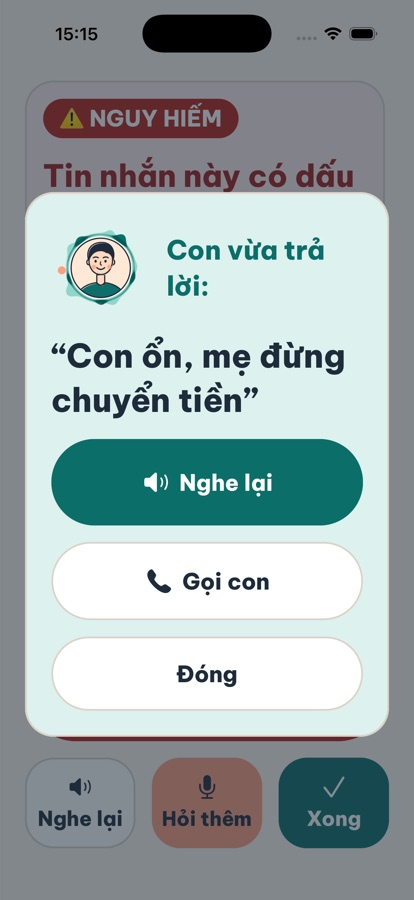
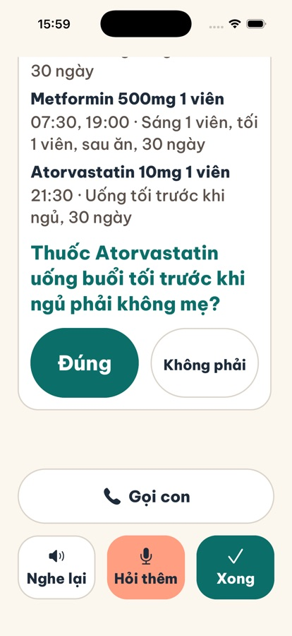
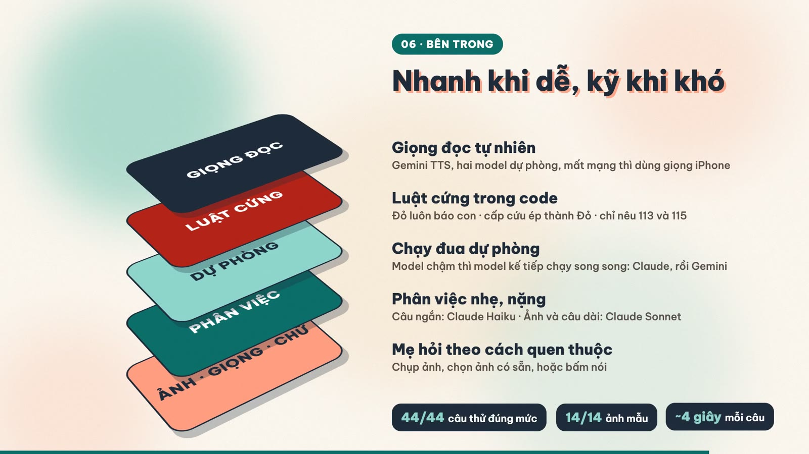
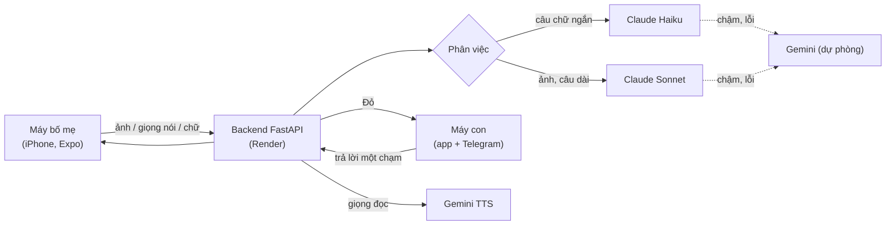

<p align="center">
  
</p>

<h1 align="center">Hỏi Con</h1>

<p align="center"><b>Bố mẹ hỏi, con luôn ở đó.</b><br>
App iPhone giúp bố mẹ lớn tuổi nhận ra tin nhắn lừa đảo, đọc giấy tờ, đơn thuốc, và luôn kéo người con vào cuộc khi có nguy hiểm.</p>

<p align="center">
  Team <b>VCV</b> · <a href="https://luma.com/l0ro71hq">Codex Community Hackathon – Hanoi</a> · chủ đề <i>AI in Your Palm</i> · 14/11/2026
</p>



## Vấn đề

Bố mẹ lớn tuổi nhận tin nhắn, cuộc gọi lừa đảo mỗi ngày, và lúc đó thường không có con bên cạnh.

- Việt Nam có khoảng **16,5 triệu người từ 60 tuổi** (2026), dự báo 20,9 triệu vào 2034.
- Cảnh báo đúng lúc có tác dụng: hệ thống SIMO của Ngân hàng Nhà nước khiến **1,9 triệu lượt khách dừng chuyển tiền**, giữ lại hơn 6.300 tỷ đồng.
- Tháng 12/2025, một cụ bà 76 tuổi ở Hà Tĩnh mang **hơn 2 tỷ đồng** ra ngân hàng chuyển cho kẻ gọi điện báo "con trai bị tai nạn". Nhân viên ngân hàng và công an phải thuyết phục nhiều lần cụ mới dừng.
- Không chỉ ở Việt Nam: người từ 60 tuổi ở Mỹ mất 7,75 tỷ USD vì lừa đảo năm 2025 (FBI IC3); ở Nhật, người từ 65 tuổi gánh 59,2% thiệt hại của "lừa đảo đặc biệt".

Lời cảnh báo bố mẹ tin nhất không phải của ngân hàng, mà là của con mình. Hỏi Con đưa người con vào đúng lúc đó.

## Hỏi Con làm gì

| | | |
|:---:|:---:|:---:|
|  |  |  |
| **1. Mẹ hỏi** bằng cách chụp ảnh, chọn ảnh có sẵn, hoặc bấm nói. Không cần gõ chữ. | **2. AI xem giúp** trong vài giây, trong lúc đó mẹ không cần bấm gì. | **3. Kết quả Đỏ, Vàng, Xanh**, chỉ rõ dấu hiệu lừa đảo, việc mẹ cần làm, và đọc to bằng giọng tự nhiên. |
|  |  |  |
| **4. Đỏ là con biết ngay**: cảnh báo kèm ảnh tới app của con và Telegram, máy con rung. | **5. Con trả lời một chạm**; máy mẹ hiện to câu của con và đọc lên. | **6. Đơn thuốc**: đọc từng thuốc, hỏi lại chỗ chưa chắc bằng hai nút, rồi lập lịch uống. |

Các việc khác:

- **Giấy tờ, hoá đơn**: đọc số tiền, hạn nộp, ngày giờ hẹn khám, việc cần mang theo.
- **Câu hỏi thường ngày bằng giọng nói**: hôm nay thứ mấy, huyết áp đo được có sao không, quên thuốc thì làm gì.
- **Cấp cứu**: câu có dấu hiệu đột quỵ, đau ngực được ép thành Đỏ, khuyên gọi 115 ngay và báo con.
- **Hai vai trên cùng một app**: máy bố mẹ (chữ to, nút to, đọc to, rung) và máy con (danh sách cảnh báo, trả lời nhanh, gọi lại).

### Thiết kế cho người lớn tuổi

- Mỗi màn hình chỉ có một việc chính, nút to hình viên thuốc, chữ to, chống bấm đúp, rung khi bấm.
- Mọi kết quả đều được đọc to; nút "Nghe lại" ở mọi nơi.
- Còn nội dung bên dưới thì hiện thanh "Còn nữa, bấm để đọc tiếp", vì nhiều người không biết kéo màn hình.
- Câu con trả lời gần nhất luôn nằm ở màn hình chính, kể cả khi đã tắt hẳn app rồi mở lại.
- Màn hình nghe tự gửi sau 3 giây im lặng; nếu máy không nghe được tiếng Việt thì gợi ý gọi con.

## Bên trong





- **Phân việc nhẹ, nặng** (`RoutedAnalyzer`): câu hỏi chữ ngắn dùng Claude Haiku cho nhanh; câu có ảnh hoặc dài hơn 300 ký tự dùng Claude Sonnet. Luật nằm trong code, không tốn thêm lượt gọi AI.
- **Chạy đua dự phòng** (`RacingAnalyzer`): model đầu chưa trả lời sau vài giây thì model kế tiếp chạy song song (Claude, rồi Gemini), lấy kết quả về trước.
- **Luật cứng trong code**, không phụ thuộc AI: kết quả Đỏ luôn báo con; cấp cứu ép thành Đỏ; chỉ được nêu số 113 và 115; không hứa thay con, không chẩn đoán, không khuyên uống bù gấp đôi.
- **Kiến thức lừa đảo trong prompt**: 6 dấu hiệu và 12 kịch bản đang phổ biến ở Việt Nam (giả công an, giả điện lực, giả con đổi số, trúng thưởng, VNeID giả...).
- **Giọng đọc tự nhiên**: Gemini TTS, có hai model dự phòng khi hết hạn mức; mất mạng hoặc chậm thì app tự đọc bằng giọng tiếng Việt của iPhone.
- **Không bỏ lỡ câu con trả lời**: máy mẹ theo dõi theo thời điểm gửi, nên backend miễn phí có xoá dữ liệu khi ngủ cũng không làm mất câu mới.

### Đã kiểm thử

| Bộ thử | Kết quả |
|---|---|
| 44 câu hỏi mẫu (lừa đảo, sức khoẻ, giấy tờ, thường ngày) qua bộ phân việc | 44/44 đúng mức, trung bình 4,1 giây |
| 14 ảnh mẫu (5 tin lừa đảo, 2 tin thật, đơn thuốc, hoá đơn, giấy hẹn, nhãn thuốc) | 14/14 đúng mức |
| Test tự động backend (LLM giả, không gọi API thật) | 63 test qua |
| Luồng đầy đủ trên hai iPhone thật (XS Max vai bố mẹ, 12 Pro Max vai con) | Chạy được, kể cả tắt hẳn app rồi mở lại |

## Người dùng đầu tiên và mở rộng

Người cài app là người con, người dùng là bố mẹ, nên đi hai kênh:

1. **Cộng đồng chống lừa đảo trên Facebook** để tìm người con: nhóm 7onez Community 218.000 thành viên, trang Chongluadao.vn 145.000 người theo dõi.
2. **Hội Người cao tuổi** để gặp bố mẹ: tập hợp 94% người cao tuổi, có tổ chức ở 3.221 xã phường, khoảng 9.000 câu lạc bộ liên thế hệ đang chạy lớp kỹ năng số và phòng lừa đảo. Bắt đầu từ 1–2 câu lạc bộ ở Hà Nội.

Mở rộng: Việt Nam, rồi Đông Nam Á, rồi các nước già hoá như Nhật, Hàn; chỉ cần đổi ngôn ngữ và bộ kịch bản lừa đảo địa phương. Mô hình doanh thu: gói gia đình do người con trả, hoặc ngân hàng, ví điện tử trả để giảm lừa đảo cho khách lớn tuổi.

## Thành viên

| GitHub | Vai trò |
|---|---|
| [Tai-TZ](https://github.com/Tai-TZ) | Trưởng nhóm |
| [kudo2022](https://github.com/kudo2022) | Thành viên |
| [Tiennd11](https://github.com/Tiennd11) | Thành viên |
| [winthebest](https://github.com/winthebest) | Thành viên |

## Công nghệ

| Phần | Công nghệ |
|---|---|
| Mobile | Expo SDK 58, React Native, TypeScript, Expo Router |
| Tính năng thiết bị | Camera và thư viện ảnh, nhận dạng giọng nói, đọc to (expo-speech, expo-audio), rung, AsyncStorage |
| Đồ họa | React Native Skia (nhân vật người con), Reanimated, font Be Vietnam Pro, phong cách in riso |
| Backend | Python 3.12, FastAPI, Pydantic, SQLite |
| AI | LangChain; Claude Sonnet và Claude Haiku (Anthropic), Gemini (Google) làm dự phòng; Gemini TTS cho giọng đọc |
| Thông báo cho con | Telegram Bot (long polling, nút trả lời nhanh) |
| Triển khai | Docker trên Render (`render.yaml`), app iOS bản Release ký bằng Apple ID miễn phí |
| Chất lượng | pytest, Ruff, TypeScript strict, ESLint |

## Bắt đầu nhanh

### Yêu cầu

- macOS có **Xcode** (kèm iOS platform) và **CocoaPods**, **Watchman**
- **Node.js** 20 trở lên
- **Python 3.12** và [**uv**](https://docs.astral.sh/uv/)
- API key của Anthropic và/hoặc Google AI Studio; token bot Telegram nếu muốn báo cho con qua Telegram

### Cài đặt

```bash
git clone https://github.com/Tai-TZ/codex-hackathon-hanoi.git
cd codex-hackathon-hanoi
make install
```

`make install` tạo môi trường Python trong `backend/.venv`, cài thư viện, tạo `backend/.env` từ file mẫu và cài thư viện cho app. Mở `backend/.env` và điền model, API key (xem [Biến môi trường](#biến-môi-trường)).

### Chạy

Mở hai terminal ở thư mục gốc:

```bash
make backend
```

```bash
make ios-sim
```

Lần đầu `make ios-sim` build app native lên simulator (vài phút). Các lần sau chỉ cần `make app` để chạy Metro. Khi mở app lần đầu, chọn vai **Bố mẹ** hoặc **Con**; giữ 3 giây ở đầu màn hình chính để đổi vai.

Ảnh mẫu để thử (tin lừa đảo, đơn thuốc, hoá đơn) có thể thả vào simulator bằng `xcrun simctl addmedia booted <ảnh>`.

## Lệnh

Chạy ở thư mục gốc. Xem đầy đủ bằng `make help`.

| Lệnh | Việc |
|---|---|
| `make install` | Cài thư viện cho backend và app |
| `make backend` | Chạy backend tại `http://localhost:8000` (tài liệu API ở `/docs`), tự nạp lại khi sửa code |
| `make app` | Chạy Metro |
| `make check` | Lint, kiểm tra định dạng và test backend; typecheck và lint app |
| `make test` | Chỉ chạy test backend |
| `make ios-sim` | Build và mở app trên simulator |
| `make ios-device` | Build bản Release lên iPhone đang cắm vào Mac |
| `make health` | Kiểm tra backend local |

## Biến môi trường

### `backend/.env`

| Biến | Bắt buộc | Mô tả |
|---|---|---|
| `LLM_MODEL` | Có | Model chính cho việc nặng. Tên bắt đầu bằng `claude` dùng Anthropic, `gemini` dùng Google, còn lại dùng OpenAI |
| `LLM_FALLBACK_MODELS` | Không | Model dự phòng, cách nhau bằng dấu phẩy; model nào chưa có key thì bị bỏ qua |
| `LLM_LIGHT_MODEL` | Không | Model cho việc nhẹ (câu chữ ngắn), ví dụ `claude-haiku-5-5`. Bỏ trống thì mọi câu dùng `LLM_MODEL` |
| `LLM_HEAVY_TEXT_CHARS` | Không | Câu dài hơn số ký tự này tính là việc nặng. Mặc định 300 |
| `LLM_STAGGER_SECONDS` | Không | Sau bao nhiêu giây thì gọi thêm model dự phòng chạy song song |
| `ANTHROPIC_API_KEY` | Khi dùng Claude | Key từ Anthropic Console |
| `GOOGLE_API_KEY` | Khi dùng Gemini hoặc giọng đọc | Key từ Google AI Studio |
| `OPENAI_API_KEY` | Khi dùng OpenAI | Key từ OpenAI Platform |
| `TTS_MODEL`, `TTS_VOICE`, `TTS_FALLBACK_MODELS` | Không | Giọng đọc Gemini TTS. Bỏ trống `TTS_MODEL` thì app dùng giọng có sẵn của máy |
| `TELEGRAM_BOT_TOKEN`, `TELEGRAM_CHAT_ID` | Không | Bot Telegram báo cảnh báo Đỏ cho con và nhận nút trả lời |
| `DB_PATH` | Không | File SQLite lưu cảnh báo và câu trả lời |
| `PARENT_TITLE`, `CHILD_NAME` | Không | Cách gọi bố mẹ trong câu trả lời (mặc định "mẹ") |
| `APP_ENV` | Không | `development` (mặc định), `production`, `test`. Ở `production`, lỗi chi tiết không trả về cho client |
| `CORS_ORIGINS`, `LOG_LEVEL` | Không | Origin cho phép; mức log |

### `app/.env`

| Biến | Bắt buộc | Mô tả |
|---|---|---|
| `EXPO_PUBLIC_API_URL` | Với bản Release | URL https của backend đã deploy. Bỏ trống khi dev |

Không commit file `.env`. Chỉ commit `.env.example`.

## API

| Method | Đường dẫn | Mô tả |
|---|---|---|
| `GET` | `/health` | Trạng thái backend, model đang dùng, Telegram đã cấu hình chưa |
| `POST` | `/api/v1/ask-json` | Bố mẹ hỏi: chữ và/hoặc ảnh base64; trả mức rủi ro, câu trả lời, việc cần làm, đơn thuốc |
| `POST` | `/api/v1/ask` | Như trên, gửi ảnh dạng multipart |
| `GET` | `/api/v1/events` | Danh sách câu bố mẹ đã hỏi, cho máy con |
| `GET` | `/api/v1/events/{id}/image` | Ảnh bố mẹ đã gửi |
| `POST` | `/api/v1/reply` | Con trả lời một cảnh báo |
| `GET` | `/api/v1/replies` | Máy bố mẹ hỏi định kỳ các câu con vừa trả lời |
| `POST` | `/api/v1/confirm` | Bố mẹ xác nhận các chỗ chưa chắc trong đơn thuốc; trả lịch uống |
| `POST` | `/api/v1/tts`, `GET` `/api/v1/tts/{id}.wav` | Tạo và tải giọng đọc tự nhiên |
| `POST` | `/api/v1/chat` | Agent hội thoại chung (LangGraph) |

## Cấu trúc thư mục

```
.
├── app/                          App Expo / React Native
│   └── src/
│       ├── app/                  Màn hình: chọn vai (index), parent/, child/
│       ├── components/           parent/ (home, listen, processing, result), child-reply-overlay, son-avatar, ui
│       ├── constants/            Màu, khoảng cách, font; thông tin gia đình demo
│       └── lib/                  api.ts, speak.ts (giọng đọc), last-reply.ts, role.ts, photo.ts
├── backend/
│   ├── src/
│   │   ├── agents/analyzer.py    Phân việc, chạy đua dự phòng, đầu ra có cấu trúc
│   │   ├── agents/prompts.py     Prompt và kiến thức lừa đảo
│   │   ├── api/routes.py         Các endpoint
│   │   ├── services/             llm.py, store.py (SQLite), telegram.py, tts.py
│   │   └── config.py             Đọc cấu hình từ .env
│   └── tests/                    Test với LLM giả
├── docs/images/                  Ảnh cho README
├── render.yaml                   Blueprint triển khai backend lên Render
├── AGENTS.md                     Hướng dẫn cho coding agent (Codex, Claude Code…)
└── Makefile                      Lệnh chung
```

## Build lên iPhone thật

Dùng Apple ID miễn phí, không cần tài khoản Apple Developer trả phí.

1. Cắm iPhone vào Mac, chọn **Trust This Computer**.
2. Trên iPhone bật **Developer Mode** (Settings → Privacy & Security), khởi động lại máy.
3. Trong Xcode → Settings → Accounts, đăng nhập Apple ID.
4. Deploy backend lên một URL https và điền `EXPO_PUBLIC_API_URL` vào `app/.env`.
5. Chạy `make ios-device`.
6. Lần đầu mở app: Settings → General → VPN & Device Management → tin cậy tài khoản developer.

Bản Release chứa sẵn code JavaScript, nên đóng hẳn rồi mở lại app vẫn chạy mà không cần Mac hay Metro. Giới hạn của Apple ID miễn phí: app hết hạn sau 7 ngày, tối đa 3 app tự cài trên mỗi máy.

## Deploy backend

Backend có sẵn `Dockerfile` và `render.yaml`. Trên Render: New → Blueprint → chọn repo này, rồi điền các biến bí mật (`ANTHROPIC_API_KEY`, `GOOGLE_API_KEY`, `TELEGRAM_BOT_TOKEN`, `TELEGRAM_CHAT_ID`). Mỗi lần push lên `main`, Render tự deploy lại.

Gói miễn phí tự "ngủ" sau khoảng 15 phút không có request (request đầu chậm 30–50 giây) và xoá dữ liệu SQLite khi ngủ hoặc deploy lại. Gọi `/health` để đánh thức trước khi demo.

## Giới hạn hiện tại

- Bản thi dùng một gia đình cố định (`demo`), chưa có đăng nhập và ghép đôi bố mẹ với con.
- Số điện thoại trong nút "Gọi con", "Gọi mẹ" là số giả.
- Lịch uống thuốc mới hiển thị và đọc to, chưa nhắc theo giờ.
- Dữ liệu trên Render miễn phí không bền; bản thật cần cơ sở dữ liệu riêng.

## Xử lý sự cố

| Hiện tượng | Cách xử lý |
|---|---|
| App báo "Không kết nối được backend" | Kiểm tra `make backend` đang chạy; điện thoại và Mac cùng mạng wifi; với bản Release, kiểm tra `EXPO_PUBLIC_API_URL` và gọi `/health` để đánh thức Render |
| Kết quả chậm hoặc lỗi model | Khai báo `LLM_FALLBACK_MODELS` để tự chuyển model |
| Giọng đọc đổi sang giọng iPhone | Gemini TTS hết hạn mức theo phút; đợi khoảng một phút |
| Telegram báo `409 Conflict` | Có hai backend cùng chạy một bot; tắt bớt một nơi |
| App đóng ngay khi mở camera hoặc micro | Thiếu câu xin quyền trong `app.json`; sửa rồi build lại native |
| `pod install` báo lỗi encoding | Chạy `export LANG=en_US.UTF-8` rồi thử lại |
| App trên iPhone không mở được nữa | Hết hạn 7 ngày của Apple ID miễn phí; chạy lại `make ios-device` |
