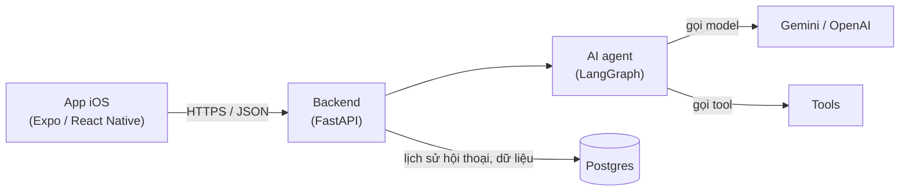
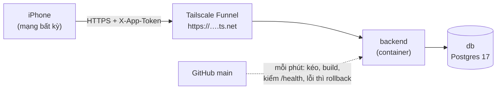

# VCV · Codex Community Hackathon Hanoi 2026

Ứng dụng di động có AI agent của **team VCV**, xây dựng cho [Codex Community Hackathon – Hanoi](https://luma.com/l0ro71hq) (chủ đề *AI in Your Palm*, 14/11/2026).

App iOS viết bằng Expo / React Native gọi một backend Python. Backend chạy một AI agent (LangGraph) có khả năng gọi tool và nhớ ngữ cảnh hội thoại.

## Thành viên

| GitHub | Vai trò |
|---|---|
| [Tai-TZ](https://github.com/Tai-TZ) | Trưởng nhóm |
| [kudo2022](https://github.com/kudo2022) | Thành viên |
| [Tiennd11](https://github.com/Tiennd11) | Thành viên |
| [winthebest](https://github.com/winthebest) | Thành viên |

## Công nghệ

| Phần | Công nghệ |
|---|---|
| Mobile | Expo SDK 58, React Native 0.88, TypeScript, Expo Router |
| Tính năng thiết bị | Camera và thư viện ảnh, nhận dạng giọng nói, đọc văn bản thành giọng nói, thông báo cục bộ, lưu trữ cục bộ, rung |
| Đồ họa và chuyển động | React Native Skia, Reanimated, linear gradient, glass effect (iOS 26), font Be Vietnam Pro |
| Backend | Python 3.12, FastAPI, Pydantic |
| Database | PostgreSQL 17 (Docker Compose), lưu lịch sử hội thoại và dữ liệu app |
| Hạ tầng | Docker Compose trên PC nhà, Tailscale Funnel (HTTPS public), tự deploy từ `main`, GitHub Actions CI |
| AI agent | LangGraph (agent kiểu ReAct), LangChain |
| Model | Google Gemini hoặc OpenAI, chọn bằng cấu hình |
| Chất lượng | pytest, Ruff, TypeScript strict, ESLint |

## Kiến trúc



Agent chạy theo vòng lặp: model đọc hội thoại, quyết định trả lời luôn hay gọi tool; nếu gọi tool thì kết quả được đưa lại cho model, lặp đến khi có câu trả lời (tối đa 12 bước).

## Bắt đầu nhanh

### Yêu cầu

- macOS có **Xcode** (kèm iOS platform) và **CocoaPods**, **Watchman**
- **Node.js** 20 trở lên
- **Python 3.12** và [**uv**](https://docs.astral.sh/uv/)
- API key của Google AI Studio (Gemini) hoặc OpenAI

### Cài đặt

```bash
git clone https://github.com/Tai-TZ/codex-hackathon-hanoi.git
cd codex-hackathon-hanoi
make install
```

`make install` tạo môi trường Python trong `backend/.venv`, cài thư viện, tạo `backend/.env` từ file mẫu và cài thư viện cho app.

Mở `backend/.env`, điền model và API key tương ứng (xem [Biến môi trường](#biến-môi-trường)).

### Chạy

Mở hai terminal ở thư mục gốc:

```bash
make backend
```

```bash
make ios-sim
```

Lần đầu `make ios-sim` build app native lên simulator (vài phút). Các lần sau chỉ cần `make app` để chạy Metro; sửa code là app tự cập nhật.

Khi dev, app tự gọi backend ở cổng 8000 trên chính máy đang chạy Metro, nên simulator và iPhone cùng mạng wifi đều dùng được mà không cần cấu hình.

## Lệnh

Chạy ở thư mục gốc. Xem đầy đủ bằng `make help`.

| Lệnh | Việc |
|---|---|
| `make install` | Cài thư viện cho backend và app |
| `make backend` | Chạy backend tại `http://localhost:8000` (tài liệu API ở `/docs`), tự nạp lại khi sửa code |
| `make app` | Chạy Metro |
| `make check` | Lint, kiểm tra định dạng và test backend; typecheck và lint app |
| `make test` | Chỉ chạy test backend |
| `make ios-sim` | Build và mở app trên simulator |
| `make ios-device` | Build bản Release lên iPhone đang cắm vào Mac |
| `make health` | Kiểm tra backend local |
| `make db` / `make db-stop` | Bật / tắt Postgres trên máy (cổng 5433) |
| `make db-psql` | Mở psql vào database |
| `make db-backup` / `make db-restore FILE=…` | Sao lưu database vào `backups/` / nạp lại |
| `make remote-health` | Kiểm tra backend public (URL trong `app/.env`) |
| `make deploy` | Deploy ngay commit mới nhất lên server |
| `make deploy-freeze` / `make deploy-unfreeze` | Tạm dừng / bật lại tự deploy |
| `make remote-logs` | Xem log backend trên server |

## Biến môi trường

### `backend/.env`

| Biến | Bắt buộc | Mô tả |
|---|---|---|
| `LLM_MODEL` | Có | Tên model. Bắt đầu bằng `gemini` (vd `gemini-3.1-flash-lite`) thì dùng Gemini, còn lại dùng OpenAI |
| `LLM_FALLBACK_MODELS` | Không | Model dự phòng, cách nhau bằng dấu phẩy. Khi model chính lỗi hoặc quá tải, agent thử lần lượt các model này. Model nào chưa có API key thì bị bỏ qua |
| `GOOGLE_API_KEY` | Khi dùng Gemini | Key từ Google AI Studio |
| `OPENAI_API_KEY` | Khi dùng OpenAI | Key từ OpenAI Platform |
| `APP_ENV` | Không | `development` (mặc định), `production`, `test`. Ở `production`, lỗi chi tiết không trả về cho client |
| `CORS_ORIGINS` | Không | Danh sách origin, cách nhau bằng dấu phẩy. Mặc định `*` |
| `LOG_LEVEL` | Không | `DEBUG`, `INFO` (mặc định), `WARNING`, `ERROR` |
| `APP_TOKEN` | Trên server | Token dùng chung với app. Có giá trị thì `/api/v1/*` đòi header `X-App-Token` khớp. Bỏ trống khi dev |
| `POSTGRES_PASSWORD` | Khi dùng Postgres | Mật khẩu Postgres của `docker-compose.yml`. Sinh bằng `openssl rand -hex 24` |
| `DATABASE_URL` | Không | Bỏ trống thì lịch sử hội thoại lưu trong RAM. Dùng Postgres trên máy: `postgresql://app:<POSTGRES_PASSWORD>@localhost:5433/app` |

### `app/.env`

| Biến | Bắt buộc | Mô tả |
|---|---|---|
| `EXPO_PUBLIC_API_URL` | Với bản Release | URL https của backend đã deploy. Bỏ trống khi dev |
| `EXPO_PUBLIC_APP_TOKEN` | Khi gọi backend public | Khớp `APP_TOKEN` của server. Bỏ trống khi dev |

Không commit file `.env`. Chỉ commit `.env.example`.

## Cấu trúc thư mục

```
.
├── app/                        App Expo / React Native
│   ├── app.json                Cấu hình app, quyền iOS, plugin
│   └── src/
│       ├── app/                Màn hình (Expo Router: mỗi file là một route)
│       ├── components/         Component dùng chung
│       ├── constants/          Màu, khoảng cách, font
│       ├── hooks/              Hook (chat, trạng thái backend, bàn phím, theme)
│       ├── lib/api.ts          Gọi backend
│       └── types/              Kiểu dữ liệu dùng chung
├── backend/                    API FastAPI + AI agent
│   ├── src/
│   │   ├── main.py             Khởi tạo app, CORS, /health
│   │   ├── config.py           Đọc cấu hình từ .env
│   │   ├── api/routes.py       Các endpoint
│   │   ├── models/schemas.py   Schema request / response
│   │   ├── services/llm.py     Khởi tạo model (Gemini / OpenAI)
│   │   └── agents/
│   │       ├── graph.py        Vòng lặp agent
│   │       ├── prompts.py      System prompt
│   │       ├── state.py        State của agent
│   │       └── tools/          Các tool agent được gọi
│   └── tests/                  Test (dùng LLM giả, không tốn API)
├── AGENTS.md                   Hướng dẫn cho coding agent (Codex…)
└── Makefile                    Lệnh chung
```

## API

| Method | Đường dẫn | Mô tả |
|---|---|---|
| `GET` | `/health` | Trạng thái backend, model đang dùng, model dự phòng, đã có API key chưa |
| `POST` | `/api/v1/chat` | Gửi một tin nhắn cho agent |

```http
POST /api/v1/chat
Content-Type: application/json

{ "message": "23 * 17 bằng bao nhiêu?", "thread_id": null }
```

```json
{ "response": "23 * 17 bằng 391.", "thread_id": "7bd3c4df…", "tools_used": ["calculate"] }
```

Gửi lại `thread_id` ở request sau để agent nhớ ngữ cảnh. Có `DATABASE_URL` thì lịch sử hội thoại lưu trong Postgres và còn sau khi khởi động lại backend; không có thì lưu trong RAM. `/health` cho biết đang dùng loại nào (`storage`) và commit nào đang chạy (`commit`).

Mã lỗi: `401` thiếu hoặc sai `X-App-Token`, `422` dữ liệu gửi lên không hợp lệ, `502` agent lỗi hoặc vượt quá số bước, `503` backend chưa có API key hoặc mất kết nối database.

## Mở rộng agent

| Việc | Sửa ở đâu |
|---|---|
| Đổi cách agent cư xử | `backend/src/agents/prompts.py` |
| Thêm tool | Viết hàm có `@tool` trong `backend/src/agents/tools/`, thêm vào `TOOLS` trong `tools/__init__.py` |
| Đổi luồng agent | `backend/src/agents/graph.py` |
| Thêm dữ liệu vào state | `backend/src/agents/state.py` |
| Thêm endpoint | `backend/src/api/routes.py` và schema trong `backend/src/models/schemas.py` |
| Đổi model | `LLM_MODEL` trong `backend/.env` |
| Thêm bảng database | `backend/src/services/schema.sql` (chỉ `CREATE TABLE IF NOT EXISTS`, chạy mỗi lần backend khởi động) |
| Endpoint đọc/ghi database | Nhận kết nối qua `Depends(get_db_conn)` trong `backend/src/services/db.py` |

Mỗi tool mới nên có test trong `backend/tests/`. Test agent dùng LLM giả (`tests/conftest.py`) để chạy nhanh và không tốn API.

## Build lên iPhone thật

Dùng Apple ID miễn phí, không cần tài khoản Apple Developer trả phí.

1. Cắm iPhone vào Mac, chọn **Trust This Computer**.
2. Trên iPhone bật **Developer Mode** (Settings → Privacy & Security), khởi động lại máy.
3. Trong Xcode → Settings → Accounts, đăng nhập Apple ID.
4. Deploy backend lên một URL https và điền `EXPO_PUBLIC_API_URL` vào `app/.env`.
5. Chạy `make ios-device`.
6. Lần đầu mở app: Settings → General → VPN & Device Management → tin cậy tài khoản developer.

Bản Release chứa sẵn code JavaScript, nên đóng hẳn rồi mở lại app vẫn chạy mà không cần Mac hay Metro.

Giới hạn của Apple ID miễn phí: app hết hạn sau 7 ngày (build lại để gia hạn), tối đa 3 app tự cài trên mỗi máy, không có Push Notification (thông báo cục bộ vẫn dùng được).

## Deploy backend

Backend production chạy trên PC nhà của [winthebest](https://github.com/winthebest) (Windows + WSL2, Docker Desktop), mở ra internet bằng Tailscale Funnel.



- **Tự deploy:** merge vào `main` thì trong khoảng 1–3 phút server tự cập nhật. Commit chỉ sửa `app/` không làm backend khởi động lại. Trước mỗi lần deploy, database được sao lưu vào `backups/` trên server. Bản mới không qua `/health` thì server tự quay về bản cũ và bỏ qua commit đó.
- **Trước giờ demo:** `make deploy-freeze` để không có gì tự deploy nữa; `make deploy-unfreeze` để bật lại.
- **Log:** `make remote-logs`; lịch sử deploy ở `~/vcv-deploy.log` trên server.

Các lệnh `deploy*` và `remote-logs` chạy qua SSH tới host `pc-linux` (Tailscale), nên chỉ máy có quyền SSH vào server mới dùng được. Người khác cứ merge vào `main`.

### Dựng server từ đầu

Trên máy Linux có Docker (WSL2 cần bật WSL integration trong Docker Desktop):

```bash
git clone https://github.com/Tai-TZ/codex-hackathon-hanoi.git ~/codex-hackathon-hanoi
cd ~/codex-hackathon-hanoi
cp backend/.env.example backend/.env && chmod 600 backend/.env
# Điền: APP_ENV=production, model + key, POSTGRES_PASSWORD, APP_TOKEN
make server-up                      # build và chạy backend + Postgres
deploy/install-auto-deploy.sh       # timer tự deploy từ main
```

Sau đó mở Funnel trên máy chạy Tailscale (ở PC nhà là Windows): `tailscale funnel --bg 8000`, rồi xem URL bằng `tailscale funnel status`.

Image cũng chạy được trên dịch vụ hỗ trợ Docker (Render, Railway, Fly.io…): build từ `backend/`, đặt sẵn `APP_ENV=production`, nghe ở cổng trong biến `PORT` (mặc định 8000), cần thêm một Postgres và `DATABASE_URL`.

## Quy trình làm việc của team

1. Kéo code mới nhất: `git pull`.
2. Làm trên nhánh riêng: `git checkout -b <tên>/<tính-năng>`.
3. Sửa code, kiểm tra trên simulator hoặc iPhone.
4. Trước khi commit: **`make check` phải qua**.
5. Commit nhỏ, mô tả rõ; push và mở Pull Request vào `main`. GitHub Actions tự chạy lại các kiểm tra (kèm test với Postgres và build image) trên mỗi PR; chỉ merge khi CI xanh, vì merge là server tự deploy.
6. Chỉ build lại native (`make ios-sim` / `make ios-device`) khi thêm thư viện native hoặc sửa `app.json`. Thêm thư viện app bằng `npx expo install <tên>` để đúng phiên bản SDK.

## Xử lý sự cố

| Hiện tượng | Cách xử lý |
|---|---|
| App báo "Không kết nối được backend" | Kiểm tra `make backend` đang chạy; điện thoại và Mac cùng mạng wifi; với bản Release, kiểm tra `EXPO_PUBLIC_API_URL` |
| App báo backend chưa có API key | Điền key tương ứng với `LLM_MODEL` trong `backend/.env`, rồi khởi động lại backend |
| Lỗi 401 từ model | Key không khớp nhà cung cấp: model `gemini-*` cần `GOOGLE_API_KEY`, còn lại cần `OPENAI_API_KEY` |
| Agent trả lỗi 502, log có `503 UNAVAILABLE` hoặc hết thời gian chờ | Model đang quá tải. Khai báo `LLM_FALLBACK_MODELS` để agent tự chuyển model, hoặc đổi `LLM_MODEL` |
| App đóng ngay khi mở camera hoặc micro | Thiếu câu xin quyền trong `app.json`; sửa rồi build lại native |
| `pod install` báo lỗi encoding | Chạy `export LANG=en_US.UTF-8` rồi thử lại |
| App trên iPhone không mở được nữa | Hết hạn 7 ngày của Apple ID miễn phí; chạy lại `make ios-device` |
| App báo `Thiếu hoặc sai X-App-Token` | `EXPO_PUBLIC_APP_TOKEN` trong `app/.env` không khớp `APP_TOKEN` của server; sửa rồi build lại |
| Backend không khởi động, báo không kết nối được Postgres | Chạy `make db`, hoặc để trống `DATABASE_URL` trong `backend/.env` để dùng RAM |
| Merge rồi mà server không đổi | `make remote-health` xem `commit`; xem `~/vcv-deploy.log` trên server (có thể đang đóng băng hoặc commit bị rollback) |
